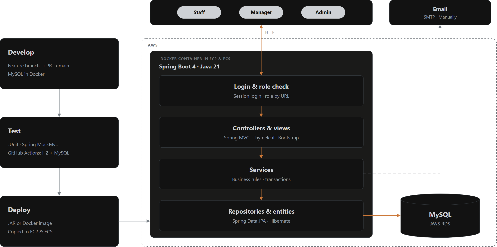
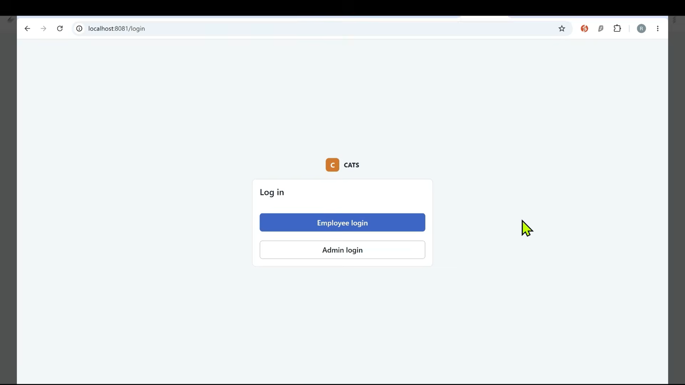

# CATS

CATS is the Course Application Tracking System developed by **Group 6 (Pioneer 6)** for the SA63 Java Web Development CA.
Employees apply for training courses and claim course fees. Managers review applications and claims. Admins maintain accounts and courses and record reimbursements.



Each request passes a session login and role check, then a Spring MVC controller, a service that holds the business rules and a Spring Data JPA repository backed by MySQL. Pages use Thymeleaf and Bootstrap, and our final page designs are in [Figma](https://www.figma.com/design/vHyqPjcmWuVVtKQP3JW2kP/CAT).

We use Java 21, Spring Boot 4, Spring Data JPA, Thymeleaf, Bootstrap and MySQL.

## Demo video

Watch the [full demo on YouTube](https://youtu.be/DRPWjqGU5vY).

[](https://youtu.be/DRPWjqGU5vY)

## Features

| Role | What they can do |
|---|---|
| Employee | See this year's training days and budget, apply from the catalogue or for another course, edit or delete pending requests, cancel or complete approved courses, claim course fees |
| Manager | Everything an employee can do for their own training, plus approve or reject team requests and claims with a reason, team course history and team reports |
| Admin | Accounts, reporting managers, annual allowances, courses, providers, categories and public holidays; reimbursements, reports with CSV export and email |

Everyone can open the training calendar.

## CA requirements

All 5 mandatory and 6 of 8 optional features (M = mandatory, O = optional). The [requirements map](docs/REQUIREMENTS.md) shows how we built each one and our [additional considerations regarding the CA requirements](docs/REQUIREMENTS.md#additional-considerations-regarding-the-ca-requirements).

| # | Requirement | Status |
|---|---|---|
| M1 | Three course categories | Done |
| M2 | Separate Employee and Admin login | Done |
| M3 | Course application with validation and status changes | Done |
| M4 | Personal course history and application details | Done |
| M5 | Manager approval and subordinate course history | Done |
| O1 | Administration | Done |
| O2 | REST API with a client | Not built |
| O3 | Course fee claims and training ledger | Done |
| O4 | Reports with CSV export | Done |
| O5 | Training calendar | Done |
| O6 | Pagination | Done |
| O7 | Email notifications | Done |
| O8 | Spring Security | Not built |

## Run locally

Install Java 21 and start Docker Desktop. Use the `main` branch.

### Get the code

For a new clone:

```sh
git clone --branch main https://github.com/bbcares1/CATS_System.git
cd CATS_System
```

For an existing clone, save your local changes and stop Spring Boot before updating:

```sh
git fetch origin
git switch main
git pull --ff-only origin main
```

### Start the application

Run from the project folder in PowerShell:

```powershell
docker compose up -d --wait
.\mvnw.cmd spring-boot:run
```

On macOS or Linux, use `./mvnw` instead of `.\mvnw.cmd`.
Open [http://localhost:8081](http://localhost:8081).

Restarting keeps your data. To restore the initial data, stop Spring Boot and follow the [local reset steps](docs/DATABASE.md#development-restart-and-reset).
For the Windows loopback error, see the [startup workaround](docs/DATABASE.md#windows-startup-error).

## Demo data and accounts

For RDS, follow the [database setup steps](docs/deploy/README.md#load-the-rds-database) to import [schema.sql](src/main/resources/db/schema.sql) and [demo-data.sql](src/main/resources/db/demo-data.sql). The scripts create the tables and add sample accounts and course records.

All demo passwords are `demo123`. We store passwords in plain text, so use these accounts only for local and classroom demos.

| Login | Workspace |
|---|---|
| `admin` | Admin login at `/admin/login` |
| `manager`, `manager2` | Employee login at `/employee/login`, Manager and own Staff pages |
| `staff`, `staff2`, `staff3` | Employee login at `/employee/login`, Staff pages |

## Project structure

```text
CATS_System/
├── src/
│   ├── main/
│   │   ├── java/group6/project/
│   │   │   ├── config/
│   │   │   ├── controller/
│   │   │   ├── form/
│   │   │   ├── model/
│   │   │   ├── repo/
│   │   │   └── service/
│   │   └── resources/
│   │       ├── db/
│   │       ├── static/
│   │       └── templates/
│   └── test/
├── docs/
│   ├── DATABASE.md
│   ├── DESIGN.md
│   ├── REQUIREMENTS.md
│   ├── deploy/
│   └── images/
├── scripts/
├── Dockerfile
├── compose.yml
├── compose.test.yml
├── compose.prod.yml
├── pom.xml
└── README.md
```

Controllers handle requests, services apply business rules, repositories query the database, and models represent stored records. Forms hold user input; templates render the pages. `db` contains the schema and demo data; `test` contains automated tests. Each Java file starts with a one-line comment describing its role.

## Tests

Run the tests with H2:

```powershell
.\mvnw.cmd test
```

Or run them with a separate MySQL test database:

```powershell
docker compose -f compose.test.yml up -d --wait
.\mvnw.cmd "-Dspring.profiles.active=mysql-test" test
```

GitHub Actions runs both on every pull request to `main`.

## Email

Manual email is under **Admin > Accounts and managers > Email**. Submissions and decisions also send notifications when SMTP is configured.
For SMTP, use `dev,mail` or `dev,qqmail` and set `CATS_MAIL_USER` and `CATS_MAIL_PASSWORD`. The `mail` profile also needs `CATS_MAIL_HOST`. Set `CATS_PUBLIC_URL` to the application's address. Without SMTP, the application still runs.

## Documentation

- [UI design](docs/DESIGN.md) and [Figma designs](https://www.figma.com/design/vHyqPjcmWuVVtKQP3JW2kP/CAT)
- [CA requirements map](docs/REQUIREMENTS.md)
- [AI usage](docs/AI_USAGE.md)
- [Database and local reset](docs/DATABASE.md)
- [EC2 and RDS demo deployment: JAR or Docker](docs/deploy/README.md)
- [Production deployment with Docker Compose](docs/deploy/PRODUCTION.md)
- [Deployment maintenance and RDS reset](docs/deploy/MAINTENANCE.md)
