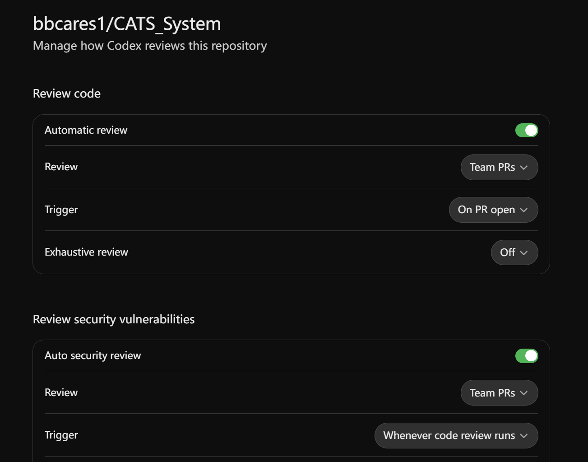
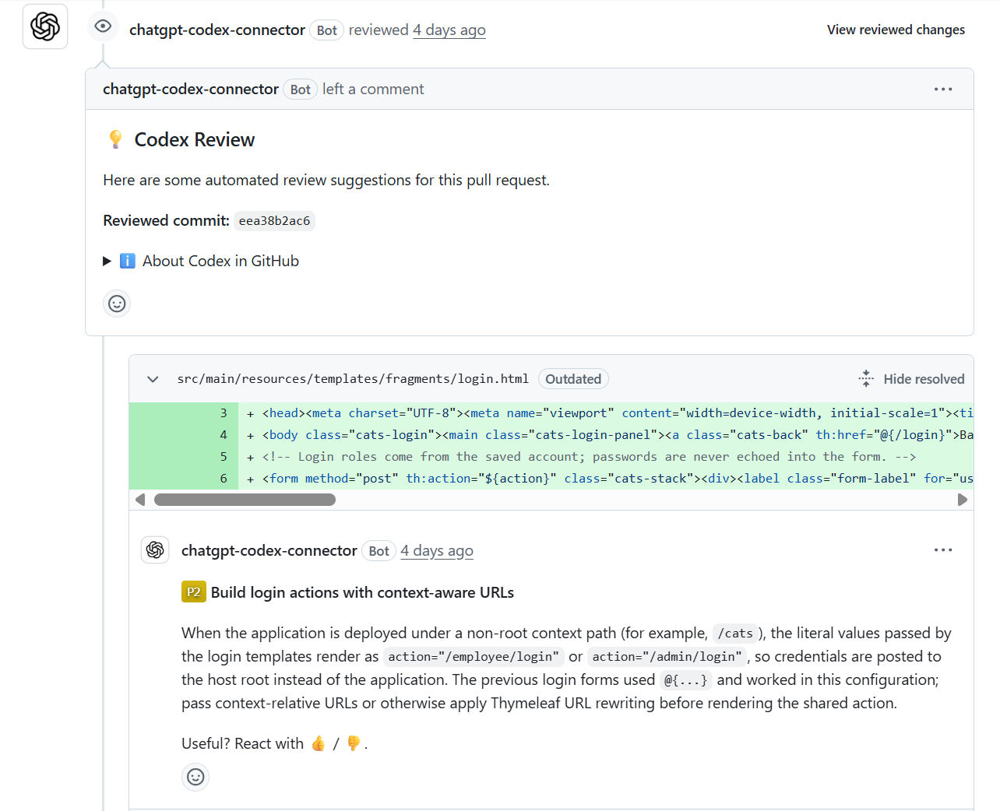

# AI usage

We used AI tools while building CATS. We reviewed and tested the submitted code and can explain it. We acknowledge these contributions and take responsibility for the final submission, including its functionality, accuracy and appropriate attribution. This page shows who used which tool, where AI helped and how we kept control.
## Done without AI

- Requirements analysis, the class diagram and all the other flow diagrams in draw.io.
- Page designs in [Figma](https://www.figma.com/design/vHyqPjcmWuVVtKQP3JW2kP/CAT).
- The first version of each module, written by its owner on their own branch.

## Who used what

| Member | Part | AI tools |
|---|---|---|
| Imran | Manager, integration | Claude Code, OpenAI Codex |
| Martin | Course applications | GitHub Copilot |
| Ryan | Staff | OpenAI Codex |
| Owen | Admin, email | OpenAI Codex |
| Jialu | Admin accounts | ChatGPT |
| Junie | Login | ChatGPT |
| Michael | Course categories, batches and fee claims | ChatGPT |
| Hong Fan | Training allowances and public holidays | ChatGPT |

## Where AI helped

1. **Integration.** When we merged the modules, they did not fit together. For example, modules kept the logged-in user under different session names, designed the user and manager tables differently and had their own SQL scripts. Our team used AI to integrate them [#40](https://github.com/bbcares1/CATS_System/pull/40).
2. **Bugs, tests and CI.** AI helped us find and fix bugs, expand the automated test suite (169 tests, run on H2 and MySQL) and set up GitHub Actions.
3. **Front-end guide.** After we brought the Figma-exported pages into Thymeleaf, we used AI to turn our styling rules into [DESIGN.md](DESIGN.md). We took the DESIGN.md idea from [VoltAgent/awesome-design-md](https://github.com/voltagent/awesome-design-md).
4. **Deployment.** Troubleshooting EC2 & ECS, RDS and Docker, and writing the [deployment guides](deploy/README.md).

## Codex code review on pull requests

We connected Codex code review to our repository. It reviewed pull request and left 14 inline comments marked P1 (high priority) or P2 (medium priority). We treated each comment as a suggestion: we checked it, then fixed it or decided against it, for example:

| Pull request | Codex comment | What we did |
|---|---|---|
| #37 | [Login and pagination forms break when the app runs under a path such as `/cats`](https://github.com/bbcares1/CATS_System/pull/37#discussion_r4234119730) | Fixed in [d8ac38e](https://github.com/bbcares1/CATS_System/pull/37/commits/d8ac38eae8e7ca0fde55b6fed2e994afa41b574c) |
| #27 | [Make Training Provider optional](https://github.com/bbcares1/CATS_System/pull/27#discussion_r4232036018) | Not taken. We kept it required and marked it as required in both forms in [924d83d](https://github.com/bbcares1/CATS_System/pull/27/commits/924d83d77bf48753a54ca06654b6c861de0fd1dc) |

**The Codex settings**

**The Codex comments on PR#37**

## How we kept control

- We worked in small batches and tested each one before the next. GitHub Actions runs all tests on every pull request.
- Each member checked the integrated version of their module and presented it in our demo.
- When AI output did not fit, we changed course. Closing the first integration attempt is the clearest example.
